# AWS Lakehouse Engineering Lab

**Do dado bruto à informação confiável para decisões de negócio.**

[](https://github.com/brodyandre/aws-lakehouse-engineering-lab/actions/workflows/validate-python.yml)
[](https://github.com/brodyandre/aws-lakehouse-engineering-lab/actions/workflows/validate-yaml.yml)
[](https://github.com/brodyandre/aws-lakehouse-engineering-lab/actions/workflows/run-tests.yml)
[](https://github.com/brodyandre/aws-lakehouse-engineering-lab/actions/workflows/data-quality.yml)

> **Um projeto de Engenharia de Dados explicado sem jargões:** imagine uma loja virtual que reúne pedidos, clientes, produtos e campanhas em sistemas diferentes. Antes de criar relatórios confiáveis, é preciso reunir, organizar e validar esses dados. Este laboratório constrói esse caminho de ponta a ponta.

**Este é um projeto autoral de portfólio, executado localmente com dados sintéticos.** A arquitetura é inspirada em serviços AWS, mas **não utiliza uma conta AWS, serviços cloud gerenciados ou dados reais de clientes**. O objetivo é demonstrar como a solução foi projetada, implementada, testada, analisada e documentada — sem apresentar o laboratório como experiência de produção.

**Navegação rápida:** [Entenda o projeto](#o-projeto-em-um-minuto) · [Veja as imagens](#demonstracao-visual) · [Confira os resultados](#resultados-e-investigacoes) · [Competências](#competencias-em-pratica) · [Documentação técnica](#índice)

<a id="o-projeto-em-um-minuto"></a>

## O projeto em um minuto

| Pergunta | Resposta simples |
| --- | --- |
| **Qual problema resolve?** | Dados comerciais podem estar espalhados, inconsistentes ou incompletos, comprometendo relatórios e indicadores. |
| **O que foi construído?** | Um processo automatizado que recebe dados simulados de e-commerce, prepara e verifica as informações e publica tabelas prontas para análise. |
| **Como as informações são utilizadas?** | Consultas de receita por categoria e mês, desempenho de campanhas, clientes e comportamento digital. |
| **Como saber se o resultado é confiável?** | Regras de qualidade, rastreamento de registros, relatórios operacionais, testes automatizados e investigação de possíveis inconsistências. |
| **Qual é a infraestrutura?** | Ambiente local com Docker, PySpark, Airflow, MinIO, DuckDB, Trino e GitHub Actions; sem contratação de serviços AWS. |

### O caminho que os dados percorrem

**Dados de pedidos e clientes** → **organização** → **validação** → **informações para decisões comerciais**.

No vocabulário da Engenharia de Dados, essas etapas são organizadas nas camadas **Raw → Bronze → Silver → Gold**. Para entender a ideia, não é necessário conhecer as ferramentas: os dados entram como foram recebidos e passam por etapas de preparação até estarem adequados à análise.

<p align="center">
  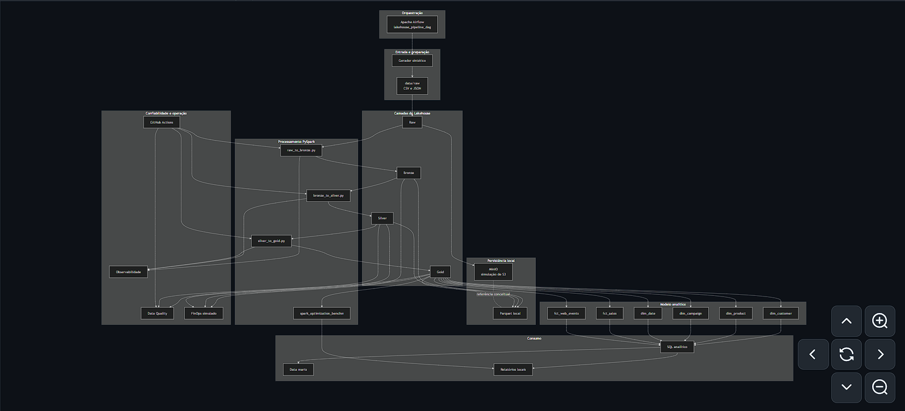
</p>
<p align="center"><em>Mapa visual do processo completo. Trata-se de uma arquitetura de laboratório, e não de infraestrutura AWS implantada em produção.</em></p>

<a id="resultados-e-investigacoes"></a>

## Resultados e investigações: o que foi demonstrado

Mais do que executar ferramentas, este repositório documenta **como conferir resultados, identificar riscos e explicar diferenças nos dados**.

| Caso documentado | Evidência do laboratório | O que demonstra |
| --- | --- | --- |
| **DE-101 — Rastreabilidade dos registros** | Dos 1.000 itens analisados na Silver, 937 foram publicados na tabela de vendas Gold. As **63 exclusões** foram explicadas: 30 por quantidade inválida e 33 vinculadas a 12 pedidos com status inválido. | Investigação de causa raiz, validação das transformações e explicação de perdas aparentes sem atribuir falhas inexistentes. |
| **DE-102 — Significado dos indicadores de receita** | O total publicado na camada analítica foi conciliado com a Gold (**R$ 1.416.127,23**). Um cenário *hipotético*, considerando apenas pedidos pagos ou enviados, resultou em **R$ 548.323,22**. | Capacidade de identificar risco de interpretação de métricas e solicitar uma definição de negócio antes de modificar o processamento. |
| **Testes de qualidade** | Na investigação DE-101, **15 verificações automatizadas** passaram, mesmo havendo registros de origem sinalizados como inválidos. | Entendimento de que validar o *tratamento* dos dados não é o mesmo que afirmar que toda a entrada está livre de erros. |

**Importante:** os números acima são resultados de investigações documentadas sobre **dados sintéticos**, não indicadores de uma empresa real. No DE-102, a diferença entre cenários **não comprova erro de receita**: a regra de reconhecimento de receita ainda precisa de definição formal.

**Leia as análises completas:** [DE-101 — divergência entre camadas](docs/incidents/de-101-raw-silver-divergence.md) · [DE-102 — semântica de receita](docs/incidents/de-102-analytics-revenue-status.md).

### Entenda o diagnóstico DE-101 em uma imagem

<p align="center">
  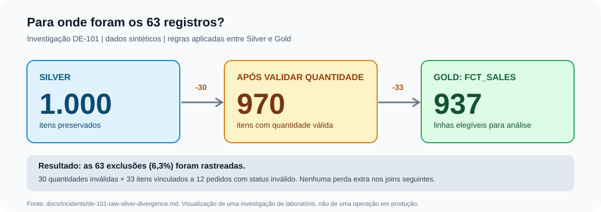
</p>
<p align="center"><em>Visualização construída a partir do relatório de investigação DE-101. É um gráfico explicativo, não uma captura de execução em tempo real.</em></p>

<a id="demonstracao-visual"></a>

## Demonstração visual do projeto

Estas imagens ajudam a reconhecer o que foi desenvolvido. Algumas são capturas de interfaces e outras são **painéis de apresentação gerados por script**. Uma imagem ilustrativa, isoladamente, não comprova que todos os serviços estavam saudáveis naquele instante; para conferir a execução, consulte o histórico do [GitHub Actions](https://github.com/brodyandre/aws-lakehouse-engineering-lab/actions), os [relatórios](reports/) e as [investigações](docs/incidents/).

| Orquestração dos processos | Qualidade dos dados |
| --- | --- |
| 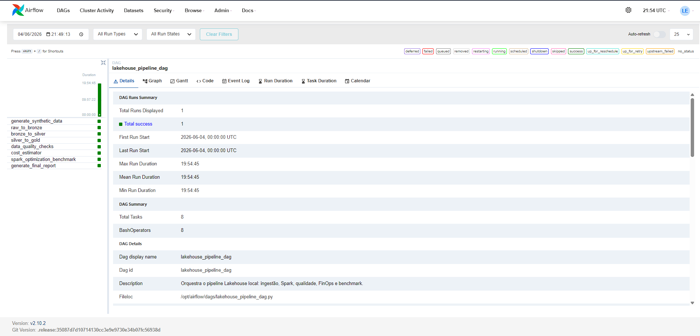 | 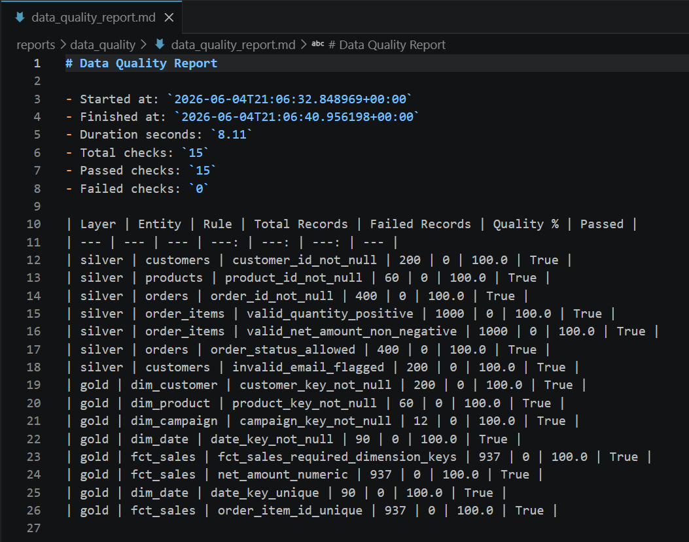 |
| **Airflow:** organiza as etapas e permite acompanhar as tarefas de processamento. [Como funciona](#orquestração-com-airflow). | **Data Quality:** verifica regras de integridade e consistência antes do consumo analítico. [Ver controles](#data-quality). |

| Acompanhamento operacional | Consulta dos resultados |
| --- | --- |
| 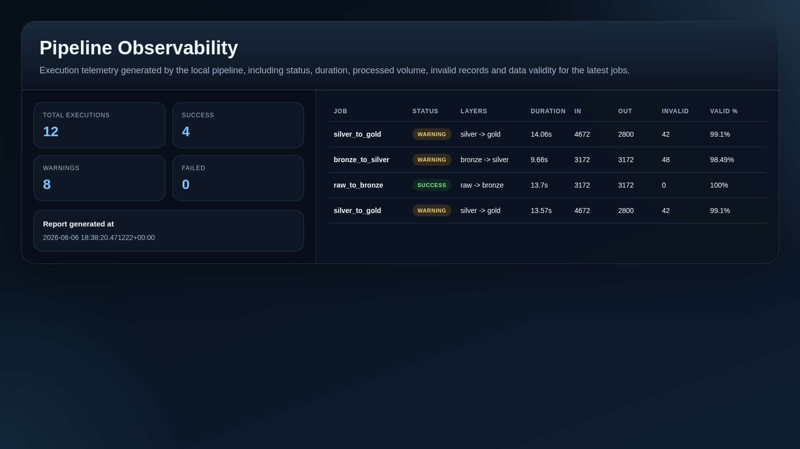 | 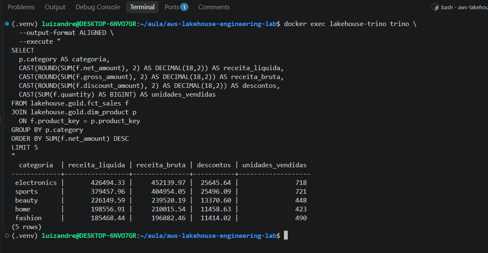 |
| **Observabilidade:** exemplo de visualização de execuções; pode usar dados substitutos quando não há relatório local. [Ver detalhes](#observabilidade). | **Consultas SQL:** painel demonstrativo com valores predefinidos; não é uma captura de query ao vivo. [Como consultar de verdade](#camada-de-query). |

> **Transparência das imagens:** o gerador [`scripts/capture_readme_screenshots.cjs`](scripts/capture_readme_screenshots.cjs) monta os painéis de observabilidade, serviços e consultas em HTML antes de fotografá-los com Playwright. O painel de serviços usa status *healthy* estático, e o de consultas contém linhas exemplificativas no código. Para novas provas operacionais, a preferência é capturar a interface real e publicar junto com data, comando e artefato de origem. Veja o [guia das imagens](assets/screenshots/readme/README.md).

<a id="competencias-em-pratica"></a>

## Competências demonstradas na prática

| Competência | Aplicação neste portfólio |
| --- | --- |
| **Construção de pipelines de dados** | Processo completo de entrada, transformação, organização e publicação de dados de e-commerce. |
| **Python, SQL e PySpark** | Automação do processamento, regras de transformação e consultas analíticas. |
| **Qualidade e governança** | Validações, sinalização de dados inválidos, investigação DE-101 e discussão de regras de negócio no DE-102. |
| **Automação e operação** | Orquestração no Airflow, testes no GitHub Actions, relatórios operacionais e diagnóstico de falhas. |
| **Arquitetura e eficiência** | Serviços locais que representam conceitos de cloud, modelagem para análise e simulação de custos (FinOps). |

**Para recrutadores e gestores:** as seções acima mostram o problema, as entregas e as evidências. **Para pessoas técnicas:** o restante do README detalha arquitetura, decisões, código, execução e limitações. É possível aprofundar cada ponto pelos links apresentados.

---

<a id="índice"></a>

<details>
<summary><strong>Índice técnico completo — abrir se quiser explorar a implementação</strong></summary>


- [Visão Geral](#visão-geral)
- [Objetivo do Projeto](#objetivo-do-projeto)
- [Problema de Negócio](#problema-de-negócio)
- [Solução Proposta](#solução-proposta)
- [Arquitetura](#arquitetura)
- [Stack Utilizada](#stack-utilizada)
- [Camadas do Lakehouse](#camadas-do-lakehouse)
- [Como Interpretar Bronze, Silver e Gold](#como-interpretar-bronze-silver-e-gold)
- [Modelagem Analítica](#modelagem-analítica)
- [Camada de Query](#camada-de-query)
- [Pipeline de Dados](#pipeline-de-dados)
- [Otimização Spark](#otimização-spark)
- [Data Quality](#data-quality)
- [Observabilidade](#observabilidade)
- [FinOps](#finops)
- [Orquestração com Airflow](#orquestração-com-airflow)
- [CI/CD com GitHub Actions](#cicd-com-github-actions)
- [Como Executar Localmente](#como-executar-localmente)
- [Troubleshooting](#troubleshooting)
- [Estrutura do Projeto](#estrutura-do-projeto)
- [Competências Demonstradas](#competências-demonstradas)
- [Mapeamento Técnico da Solução](#mapeamento-tecnico-da-solucao)
- [Evidências Esperadas](#evidências-esperadas)
- [Roadmap](#roadmap)
- [Limitações](#limitações)
- [Próximos Passos](#próximos-passos)
- [Como Este Projeto Simula AWS Sem Custo](#como-este-projeto-simula-aws-sem-custo)

</details>

<a id="visão-geral"></a>

## Visão Geral

`aws-lakehouse-engineering-lab` demonstra como estruturar um pipeline analítico moderno em um laboratório reproduzível e local-first. O foco do projeto é mostrar organização por camadas, modelagem dimensional, processamento distribuído, governança mínima, automação e rastreabilidade operacional de forma honesta, sem afirmar uso produtivo de AWS, Databricks ou ambientes corporativos reais.

O laboratório foi pensado para leitura técnica estruturada, demonstração prática da solução e avaliação objetiva de arquitetura, implementação e documentação.

[⬆️ Voltar ao índice](#índice)

<a id="objetivo-do-projeto"></a>

## Objetivo do Projeto

Criar um laboratório 100% local, gratuito e reproduzível que simule uma arquitetura Lakehouse inspirada em AWS para cenários de e-commerce e marketing. O projeto busca evidenciar boas práticas de Engenharia de Dados em ingestão, transformação, qualidade, observabilidade, custo e automação sem depender de cloud real.

[⬆️ Voltar ao índice](#índice)

<a id="problema-de-negócio"></a>

## Problema de Negócio

Times de dados frequentemente precisam transformar eventos operacionais, campanhas, pedidos e comportamento digital em uma base analítica confiável para responder perguntas como:

- quais categorias e campanhas geram mais receita;
- quais clientes têm maior valor;
- como garantir qualidade antes do consumo analítico;
- como medir execução, custo e performance sem depender de serviços pagos;
- como demonstrar uma arquitetura moderna de dados com clareza técnica e baixo custo.

[⬆️ Voltar ao índice](#índice)

<a id="solução-proposta"></a>

## Solução Proposta

O projeto propõe um pipeline Lakehouse local-first com:

- geração de dados sintéticos consistentes entre entidades de negócio;
- camadas `Raw`, `Bronze`, `Silver` e `Gold`;
- processamento distribuído com `PySpark`, usando `Spark Connect` como endpoint opcional de exploração;
- modelagem analítica em `Star Schema`;
- orquestração com `Apache Airflow 3`, separando `core` e `execution`;
- serving analítico com `DuckDB` e `Trino`;
- validações automatizadas de `Data Quality`;
- observabilidade baseada em métricas, logs e relatórios locais;
- simulação de `FinOps` por volume de arquivos;
- `Docker Compose` dedicado por stack para facilitar exploração do repositório;
- validação contínua com `GitHub Actions`.

[⬆️ Voltar ao índice](#índice)

<a id="arquitetura"></a>

## Arquitetura

Resumo do fluxo:

1. dados sintéticos são gerados em `data/raw`;
2. o `MinIO` simula object storage S3-compatible;
3. jobs `PySpark` promovem os dados entre `Raw`, `Bronze`, `Silver` e `Gold`;
4. o `Spark Connect` expõe o cluster Spark como endpoint remoto para desenvolvimento e experimentação;
5. a camada `Gold` materializa fatos e dimensões em `Star Schema`;
6. o `Airflow 3` separa `core API` e `execution API` para aproximar a topologia de um ambiente mais modular;
7. `DuckDB` e `Trino` publicam uma camada de query fácil de demonstrar para visitantes;
8. Data Quality, Observabilidade, FinOps e benchmark geram evidências em `reports/`;
9. o `GitHub Actions` valida código, YAML, testes e qualidade mínima do pipeline.

Documentação complementar:

- [Arquitetura detalhada](docs/architecture.md)
- [Diagrama Mermaid](diagrams/architecture.md)

<p align="center">
  
</p>
<p align="center"><em>Visão sistêmica do laboratório com ingestão, processamento PySpark, camadas Raw, Bronze, Silver e Gold, consumo analítico e pilares operacionais.</em></p>


[⬆️ Voltar ao índice](#índice)

<a id="stack-utilizada"></a>

## Stack Utilizada

| Categoria | Tecnologia | Papel no projeto |
| --- | --- | --- |
| Object storage local | MinIO | Simula buckets e fluxo estilo S3 |
| Processamento distribuído | PySpark | Ingestão, transformação e publicação entre camadas |
| Acesso remoto ao cluster | Spark Connect | Permite desacoplar clientes Spark do runtime do cluster |
| Orquestração | Apache Airflow 3 | Agenda, dependências, retries e histórico com `core` e `execution` separados |
| Formato analítico | Parquet | Persistência colunar em Bronze, Silver e Gold |
| Modelagem analítica | SQL + Star Schema | Camada Gold e consultas de negócio |
| Query serving | DuckDB + Trino | Publica tabelas Gold e consultas analíticas para exploração SQL |
| Qualidade de dados | PySpark + testes | Validação de consistência em Silver e Gold |
| Observabilidade | Relatórios JSON e Markdown | Evidência operacional local |
| FinOps | Estimador local de custo | Simulação de storage, scan e otimização |
| CI/CD | GitHub Actions | Lint, testes, YAML e Data Quality em pipeline público |
| Ambiente | Docker Compose modular | Execução local reproduzível por stack ou em modo completo |

[⬆️ Voltar ao índice](#índice)

<a id="camadas-do-lakehouse"></a>

## Camadas do Lakehouse

| Camada | Objetivo | Características principais |
| --- | --- | --- |
| `Raw` | Receber dados de origem | Dados próximos do original, em `CSV` e `JSON` |
| `Bronze` | Padronização estrutural mínima | Conversão para `Parquet`, colunas técnicas e rastreabilidade |
| `Silver` | Conformidade e qualidade | Tipagem, padronização, sinalização de inválidos e regras de negócio |
| `Gold` | Consumo analítico | Fatos, dimensões, métricas e consultas de negócio |

[⬆️ Voltar ao índice](#índice)

<a id="como-interpretar-bronze-silver-e-gold"></a>

## Como Interpretar Bronze, Silver e Gold

Neste laboratório, `Bronze`, `Silver` e `Gold` representam a evolução dos dados ao longo do pipeline, não níveis de senioridade ou maturidade do projeto.

- **Bronze**: primeira camada confiável para trabalho analítico, com dados já convertidos para `Parquet` e rastreáveis por processamento.
- **Silver**: camada em que os dados passam por padronização, tipagem, regras de negócio e sinais de qualidade.
- **Gold**: camada voltada para consumo analítico, com fatos, dimensões e métricas organizadas para consultas e reporting.

Essa distinção ajuda a comunicar com clareza onde cada transformação acontece e por que cada camada existe dentro do fluxo Lakehouse.

[⬆️ Voltar ao índice](#índice)

<a id="modelagem-analítica"></a>

## Modelagem Analítica

A camada `Gold` foi desenhada em `Star Schema` para simplificar análise, leitura por ferramentas de BI e comunicação com públicos analíticos. O modelo centraliza métricas de negócio em fatos e atributos descritivos em dimensões.

Tabelas principais:

- dimensões: `dim_customer`, `dim_product`, `dim_campaign`, `dim_date`;
- fatos: `fct_sales`, `fct_web_events`.

Perguntas de negócio suportadas:

- receita por categoria;
- receita por mês;
- performance de campanhas;
- top clientes;
- comportamento digital por canal e sessão.

Mais detalhes em [docs/data-modeling.md](docs/data-modeling.md).

<p align="center">
  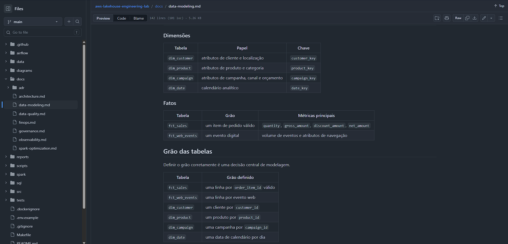
</p>
<p align="center"><em>Exemplo de visão da camada Gold com dimensões e fatos analíticos.</em></p>


[⬆️ Voltar ao índice](#índice)

<a id="camada-de-query"></a>

## Camada de Query

Além da Gold em Parquet, o laboratório materializa um catálogo local em `DuckDB` e o expõe para exploração SQL com `Trino`. Isso melhora muito a experiência de demonstração do repositório, porque permite sair do discurso de transformação e chegar até uma superfície de consumo analítico.

O fluxo de serving funciona assim:

1. a camada `Gold` é gerada pelos jobs Spark;
2. o script `scripts/build_serving_catalog.py` carrega as tabelas Gold para `data/serving/lakehouse.duckdb`;
3. consultas de `sql/analytics/` são materializadas no schema `analytics`;
4. o `Trino` expõe esse catálogo para navegação e consultas SQL.

Consultas que ficam prontas para demonstração:

- `lakehouse.analytics.revenue_by_category`
- `lakehouse.analytics.campaign_performance`
- `lakehouse.analytics.events_by_channel`
- `lakehouse.analytics.top_customers`
- `lakehouse.analytics.revenue_by_month`

Comandos validados localmente para explorar essa camada:

```bash
docker exec lakehouse-trino trino --execute 'SHOW CATALOGS'
docker exec lakehouse-trino trino --execute 'SHOW TABLES FROM lakehouse.analytics'
docker exec lakehouse-trino trino --execute 'SELECT * FROM lakehouse.analytics.revenue_by_category LIMIT 5'
```

<p align="center">
  
</p>
<p align="center"><em>Painel ilustrativo de exploração SQL via Trino. Os valores de linhas exibidos foram definidos no gerador da imagem; consulte a seção de comandos para executar queries reais.</em></p>

[⬆️ Voltar ao índice](#índice)

<a id="pipeline-de-dados"></a>

## Pipeline de Dados

Fluxo principal do laboratório:

1. `generate_synthetic_data`
2. `raw_to_bronze`
3. `bronze_to_silver`
4. `silver_to_gold`
5. `data_quality_checks`
6. `cost_estimator`
7. `build_serving_catalog`
8. `spark_optimization_benchmark`, opcional
9. `generate_final_report`

Esse encadeamento permite demonstrar ingestão, transformação, consumo analítico e geração de evidências técnicas em uma mesma trilha operacional.

[⬆️ Voltar ao índice](#índice)

<a id="otimização-spark"></a>

## Otimização Spark

O projeto usa `PySpark` para transformar dados entre camadas e materializar a camada analítica. Além da funcionalidade, o laboratório inclui um benchmark dedicado para comparar uma execução não otimizada com outra otimizada.

Técnicas demonstradas:

- `cache`;
- `broadcast join`;
- ajuste de `shuffle partitions`;
- `repartition` e `coalesce`;
- `Adaptive Query Execution`;
- `column pruning`.

Mais detalhes em [docs/spark-optimization.md](docs/spark-optimization.md).

[⬆️ Voltar ao índice](#índice)

<a id="data-quality"></a>

## Data Quality

A camada de Data Quality valida `Silver` e `Gold` com regras automatizadas de:

- completude;
- validade;
- consistência;
- unicidade;
- integridade mínima para consumo analítico.

Artefatos gerados:

- `reports/data_quality/data_quality_report.md`
- `reports/data_quality/data_quality_results.json`

Mais detalhes em [docs/data-quality.md](docs/data-quality.md).

<p align="center">
  
</p>
<p align="center"><em>Relatório de qualidade de dados com regras aplicadas nas camadas Silver e Gold.</em></p>


[⬆️ Voltar ao índice](#índice)

<a id="observabilidade"></a>

## Observabilidade

O projeto registra evidências operacionais por execução com foco em:

- duração dos jobs;
- volumes de entrada e saída;
- registros inválidos;
- artefatos gerados;
- tamanho aproximado dos arquivos;
- status `success`, `warning` ou `failed`.

Artefatos gerados:

- `reports/observability/pipeline_metrics.md`
- `reports/observability/pipeline_metrics.json`

Mais detalhes em [docs/observability.md](docs/observability.md).

<p align="center">
  
</p>
<p align="center"><em>Painel de apresentação de métricas operacionais; usa o relatório local quando disponível e pode recorrer a valores substitutos na ausência desse relatório.</em></p>


[⬆️ Voltar ao índice](#índice)

<a id="finops"></a>

## FinOps

O módulo de FinOps simula custo de dados sem usar AWS real e sem consultar billing. A lógica usa apenas o volume de arquivos local para estimar:

- storage estilo S3;
- scan estilo Athena;
- risco de `small files`;
- economia potencial com `Parquet` e particionamento.

Artefatos gerados:

- `reports/finops/cost_estimation.md`
- `reports/finops/cost_estimation.json`

Mais detalhes em [docs/finops.md](docs/finops.md).

<p align="center">
  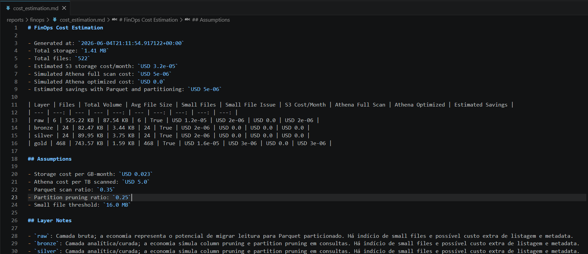
</p>
<p align="center"><em>Simulação local de FinOps com estimativas de storage, scan e economia por otimização.</em></p>


[⬆️ Voltar ao índice](#índice)

<a id="orquestração-com-airflow"></a>

## Orquestração com Airflow

O pipeline principal é orquestrado pela DAG `lakehouse_pipeline_dag`, localizada em [airflow/dags/lakehouse_pipeline_dag.py](airflow/dags/lakehouse_pipeline_dag.py).

Por padrão, os jobs Spark executados pela DAG usam o cluster standalone local via `spark://spark-master:7077`. O endpoint `Spark Connect` continua exposto para experimentação, mas não é usado por padrão; `AIRFLOW_SPARK_REMOTE` permanece vazio por causa de uma regressão de serialização observada no Spark `3.5.x` com cluster standalone.

Objetivos da orquestração:

- materializar dependências entre etapas;
- tornar reexecução mais previsível;
- evidenciar retries e status de tasks;
- aproximar a experiência local do tipo de operação esperado em ambientes gerenciados.

<p align="center">
  
</p>
<p align="center"><em>Resumo da DAG no Airflow local, com status das tasks e visão operacional da execução.</em></p>


[⬆️ Voltar ao índice](#índice)

<a id="cicd-com-github-actions"></a>

## CI/CD com GitHub Actions

O repositório inclui workflows públicos para:

| Workflow | Objetivo |
| --- | --- |
| `validate-python.yml` | lint de Python e testes unitários |
| `validate-yaml.yml` | validação de YAML, Compose e workflows |
| `run-tests.yml` | testes unitários e integrações leves |
| `data-quality.yml` | pipeline reduzido com geração de dados e validações de qualidade |

Além da automação, o projeto registra decisões e troubleshooting em artefatos úteis para avaliação técnica:

- ADRs em `docs/adr/`;
- documentação temática em `docs/`;
- scripts operacionais em `scripts/`;
- `Makefile` para padronizar comandos recorrentes.

<p align="center">
  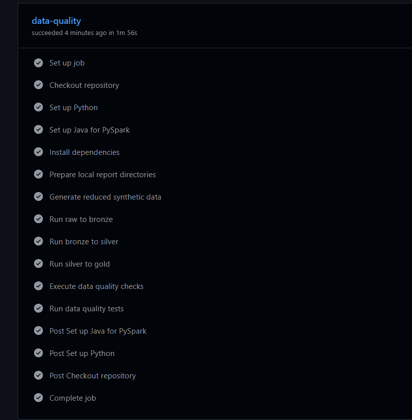
</p>
<p align="center"><em>Captura do workflow de validação; confira os resultados atuais e verificáveis no link do GitHub Actions acima.</em></p>


[⬆️ Voltar ao índice](#índice)

<a id="como-executar-localmente"></a>

## Como Executar Localmente

### Pré-requisitos

- `Docker`
- `Docker Compose`
- `Python 3.10+`
- `make`

### Subindo o ambiente

```bash
cp .env.example .env
make init
make up
```

### Subindo stacks específicas

```bash
make up-storage   # MinIO e bootstrap dos buckets
make up-spark     # storage + Spark master/worker + Spark Connect
make up-airflow   # Airflow 3 com core/execution separados
make up-query     # Trino
```

Para a stack de query, a experiência fica completa depois de materializar o catálogo local com `make run-local` ou `make trino-catalog`, porque o `Trino` lê o arquivo `data/serving/lakehouse.duckdb`.

Por padrão, o `Airflow` fica apontado para `spark://spark-master:7077` e deixa `AIRFLOW_SPARK_REMOTE` vazio. O endpoint `Spark Connect` continua exposto em `sc://localhost:15002`, mas ficou fora do caminho padrão do pipeline por causa de uma regressão aberta no `Spark 3.5.x` quando o `Connect` usa executores remotos em cluster standalone.

Se quiser avaliar a variante enterprise do storage, existe um overlay opcional para `AIStor`:

```bash
make up-aistor
```

Nesse caso é necessário ajustar `AISTOR_LICENSE_PATH` no `.env`.

### Preparando ambiente Python local

```bash
make setup-dev
source .venv/bin/activate
```

### Validando o ambiente e rodando o pipeline local

```bash
make check
make run-local
# opcional: regenerar apenas a camada de query
make trino-catalog
```

Validar a camada SQL via `Trino`:

```bash
docker exec lakehouse-trino trino --execute 'SHOW CATALOGS'
docker exec lakehouse-trino trino --execute 'SHOW TABLES FROM lakehouse.analytics'
docker exec lakehouse-trino trino --execute 'SELECT * FROM lakehouse.analytics.revenue_by_category LIMIT 5'
```

### Limpando saídas geradas

```bash
make clean-outputs
```

### Acessos locais

| Componente | URL |
| --- | --- |
| Airflow Core API / UI | `http://localhost:8088` |
| Airflow Execution API | `http://localhost:8089` |
| MinIO API | `http://localhost:9000` |
| MinIO Console | `http://localhost:9001` |
| Spark Master UI | `http://localhost:18080` |
| Spark Worker UI | `http://localhost:18081` |
| Spark Connect | `sc://localhost:15002` |
| Trino | `http://localhost:8085` |

Credenciais locais padrão:

- Airflow usuário: `admin`
- Airflow senha: `admin`
- MinIO usuário: `minioadmin`
- MinIO senha: `minioadmin123`

<p align="center">
  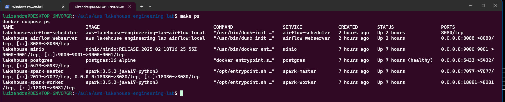
</p>
<p align="center"><em>Ilustração dos serviços do laboratório. O status 'healthy' exibido no painel é predefinido no gerador e não comprova a disponibilidade atual dos serviços.</em></p>


### Executando o pipeline por etapas

Gerar dados sintéticos:

```bash
python3 src/ingestion/generate_synthetic_data.py
```

Promover `Raw` para `Bronze`:

```bash
python3 spark/jobs/raw_to_bronze.py
```

Promover `Bronze` para `Silver`:

```bash
python3 spark/jobs/bronze_to_silver.py
```

Promover `Silver` para `Gold`:

```bash
python3 spark/jobs/silver_to_gold.py
```

Executar Data Quality:

```bash
python3 src/quality/data_quality_checks.py \
  --silver-dir data/silver \
  --gold-dir data/gold \
  --report-path reports/data_quality/data_quality_report.md \
  --json-path reports/data_quality/data_quality_results.json \
  --master local[*]
```

Executar FinOps simulado:

```bash
python3 src/finops/cost_estimator.py
```

Materializar a camada de serving consumida pelo Trino:

```bash
python3 scripts/build_serving_catalog.py
```

Executar benchmark Spark:

```bash
python3 spark/benchmarks/spark_optimization_benchmark.py \
  --gold-dir data/gold \
  --report-path reports/pipeline_runs/spark_optimization_benchmark.md \
  --master local[*]
```

### Executando pelo Airflow

1. abra `http://localhost:8088`;
2. entre com `admin / admin`;
3. localize a DAG `lakehouse_pipeline_dag`;
4. despause a DAG, se necessário;
5. acione uma execução manual.

<p align="center">
  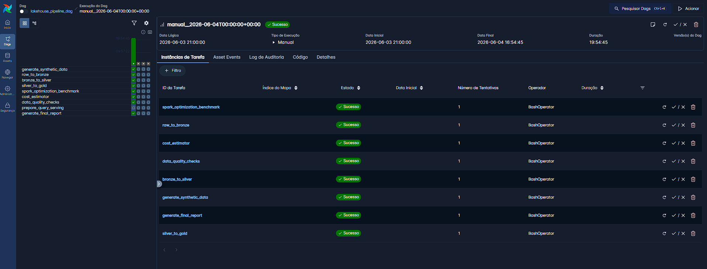
</p>
<p align="center"><em>Execução da DAG com tasks concluídas com sucesso.</em></p>


[⬆️ Voltar ao índice](#índice)

<a id="troubleshooting"></a>

## Troubleshooting

Alguns problemas recorrentes neste laboratório e como diagnosticá-los rapidamente:

### 1. `make check` falha logo no início

Esse cenário normalmente indica ausência de dependências locais, problemas no `.env` ou falta de `Java` para os jobs Spark.

Comandos úteis:

```bash
make check
make setup-dev
python3 --version
java -version
```

### 2. Os containers sobem parcialmente ou algum serviço fica indisponível

Quando Airflow, MinIO ou Postgres não sobem corretamente, vale olhar o estado dos serviços e os logs do Compose antes de tentar reexecutar o pipeline.

Comandos úteis:

```bash
make ps
docker compose logs --tail=200 postgres minio airflow-webserver airflow-scheduler
```

### 3. A DAG não aparece no Airflow ou não executa como esperado

Se a interface abre, mas a DAG `lakehouse_pipeline_dag` não aparece ou falha cedo, o primeiro passo é conferir a inicialização do Airflow e listar as DAGs carregadas.

Comandos úteis:

```bash
docker compose logs --tail=200 airflow-init
docker compose exec airflow-webserver airflow dags list
```

### 4. Jobs PySpark falham em execução local

Na maior parte dos casos, isso está ligado a `Java`, variáveis de ambiente ou diferenças entre a execução local e o ambiente do container.

Comandos úteis:

```bash
make check
docker compose exec airflow-webserver env | grep SPARK_MASTER_URL
docker compose exec airflow-webserver python3 --version
```

### 5. Relatórios ou datasets não são gerados como esperado

Se os artefatos em `reports/` ou os dados em `data/` ficam inconsistentes após várias execuções, é melhor limpar as saídas e rodar o pipeline novamente de forma controlada.

Comandos úteis:

```bash
make clean-outputs
make run-local
make final-report
```

### 6. Um workflow do GitHub Actions falha, mas localmente parece tudo certo

O caminho mais prático é reproduzir localmente os mesmos blocos de validação usados no repositório.

Comandos úteis:

```bash
make lint
make test
make smoke
```

[⬆️ Voltar ao índice](#índice)

<a id="estrutura-do-projeto"></a>

## Estrutura do Projeto

```text
aws-lakehouse-engineering-lab/
├── assets/
├── airflow/
├── compose/
├── data/
├── diagrams/
├── docs/
├── reports/
├── scripts/
├── spark/
├── sql/
├── src/
├── tests/
├── trino/
├── .github/workflows/
├── docker-compose.yml
├── Makefile
├── pyproject.toml
├── requirements.txt
└── README.md
```

Áreas principais:

- `src/`: configuração, geração de dados, qualidade, observabilidade e FinOps;
- `spark/jobs/`: jobs `Raw -> Bronze -> Silver -> Gold`;
- `spark/benchmarks/`: benchmark de otimização Spark;
- `airflow/dags/`: orquestração do pipeline e publishing da camada de serving;
- `compose/`: composes dedicados por stack (`storage`, `spark`, `airflow`, `query`);
- `trino/`: configuração da camada de query;
- `docs/`: documentação temática e ADRs;
- `assets/screenshots/readme/`: evidências visuais do README organizadas por tema;
- `sql/`: DDL, analytics e data marts;
- `data/serving/`: catálogo DuckDB publicado para consumo via Trino;
- `tests/`: testes unitários, integração e Data Quality.

[⬆️ Voltar ao índice](#índice)

<a id="competências-demonstradas"></a>

## Competências Demonstradas

| Competência | Como é demonstrada neste projeto | Evidências principais |
| --- | --- | --- |
| Arquitetura de dados em nuvem AWS | Simulação local de uma arquitetura inspirada em AWS, com object storage S3-compatible, camadas de lakehouse, processamento distribuído e orquestração. | `docs/architecture.md`, `diagrams/architecture.md`, ADRs |
| Data Lake / Lakehouse | Organização por camadas `Raw`, `Bronze`, `Silver` e `Gold`, com separação clara entre ingestão, conformidade e consumo analítico. | `data/`, jobs Spark, documentação de arquitetura |
| PySpark | Jobs de ingestão, transformação e modelagem analítica implementados em Spark local. | `spark/jobs/` |
| Otimização Spark | Benchmark comparando execução não otimizada e otimizada com `cache`, `broadcast`, `AQE`, `repartition` e `coalesce`. | `spark/benchmarks/`, `docs/spark-optimization.md` |
| Modelagem Star Schema | Construção de dimensões e fatos analíticos para consumo por SQL e BI. | `spark/jobs/silver_to_gold.py`, `sql/ddl/`, `docs/data-modeling.md` |
| Orquestração com Airflow | DAG local com dependências, retries e pipeline completo ponta a ponta. | `airflow/dags/lakehouse_pipeline_dag.py` |
| Arquitetura orientada a serviços | Airflow 3 com `core` e `execution` separados e composes especializados por stack. | `docker-compose.yml`, `compose/` |
| Query engine | Catálogo de serving materializado em DuckDB e exposto para SQL via Trino. | `scripts/build_serving_catalog.py`, `trino/` |
| Data Quality | Regras automatizadas para Silver e Gold, com relatórios em Markdown e JSON. | `src/quality/`, `tests/data_quality/`, `reports/data_quality/` |
| Observabilidade | Coleta de métricas de execução, status, volumes processados e artefatos gerados. | `src/observability/`, `reports/observability/` |
| FinOps | Estimativa local de custo de storage e scan, análise de small files e economia com Parquet e particionamento. | `src/finops/`, `docs/finops.md`, `reports/finops/` |
| CI/CD | Workflows públicos para lint, YAML, testes e Data Quality em ambiente automatizado. | `.github/workflows/` |
| Versionamento | Estrutura organizada para evolução incremental, automação e colaboração em repositório público. | GitHub Actions, convenções de projeto, `Makefile` |
| Argumentação técnica | Decisões arquiteturais registradas com contexto, alternativas e trade-offs. | `docs/adr/` |
| Documentação profissional e troubleshooting | Documentação técnica em português, scripts operacionais, checagem de ambiente e limpeza de saídas. | `README.md`, `docs/`, `scripts/check_environment.sh`, `scripts/run_pipeline_local.sh` |

[⬆️ Voltar ao índice](#índice)

<a id="mapeamento-tecnico-da-solucao"></a>

## Mapeamento Técnico da Solução

| Capacidade técnica | Como o projeto cobre |
| --- | --- |
| Experiência com arquitetura de dados em nuvem AWS | Simula localmente um Lakehouse inspirado em AWS usando MinIO como object storage S3-compatible, camadas Bronze/Silver/Gold e documentação arquitetural. |
| Conhecimento em Data Lake / Lakehouse | Estrutura o pipeline em camadas com responsabilidades claras, rastreabilidade e dados analíticos materializados em Parquet. |
| Experiência com PySpark | Implementa jobs para ingestão, limpeza, transformação e modelagem analítica com Spark local. |
| Otimização de processamento distribuído | Compara uma abordagem não otimizada e outra otimizada com técnicas clássicas de tuning em Spark. |
| Modelagem dimensional | Constrói `dim_customer`, `dim_product`, `dim_campaign`, `dim_date`, `fct_sales` e `fct_web_events` em `Star Schema`. |
| Orquestração de pipelines | Encadeia as etapas do laboratório em uma DAG Airflow com dependências, retries e execução manual ou agendada. |
| Capacidade de serving analítico | Publica consultas analíticas em uma camada de query demonstrável com DuckDB e Trino. |
| Data Quality | Automatiza regras para Silver e Gold, gerando relatórios e testes específicos de qualidade. |
| Observabilidade de dados | Registra métricas de execução, volumes, inválidos, artefatos e status por job. |
| Controle de custos em dados | Simula FinOps com estimativas de storage, scan, small files e economia com Parquet e particionamento. |
| CI/CD e automação | Usa GitHub Actions para validar código, YAML, testes e Data Quality sem depender de serviços pagos. |
| Documentação e comunicação técnica | Explica arquitetura, governança, modelagem, otimização, FinOps e decisões arquiteturais em linguagem objetiva e profissional. |
| Capacidade de troubleshooting e operação local | Inclui scripts para validar ambiente, executar o pipeline ponta a ponta, limpar saídas e consolidar relatório final. |

[⬆️ Voltar ao índice](#índice)

<a id="evidências-esperadas"></a>

## Evidências Esperadas

Ao executar o laboratório, espera-se gerar evidências técnicas como:

- relatórios de pipeline em `reports/pipeline_runs/`;
- relatórios de Data Quality em `reports/data_quality/`;
- métricas de observabilidade em `reports/observability/`;
- estimativas de FinOps em `reports/finops/`;
- catálogo de serving em `data/serving/` e `reports/query/`;
- datasets `Parquet` em `data/bronze`, `data/silver` e `data/gold`;
- histórico de execução e dependências no Airflow;
- validações automatizadas no GitHub Actions.

### Como comprovar e atualizar as evidências visuais

As imagens desta página já estão versionadas em [`assets/screenshots/readme/`](assets/screenshots/readme/). O [guia de imagens](assets/screenshots/readme/README.md) diferencia capturas de tela de painéis demonstrativos. Ao atualizar a vitrine, priorize capturas com identificação de data/execução e links verificáveis (DAG do Airflow, execução do GitHub Actions, saída de SQL e relatórios gerados). Evite reproduzir como prova de disponibilidade os estados e as tabelas ilustrativos do script de captura.

[⬆️ Voltar ao índice](#índice)

<a id="roadmap"></a>

## Roadmap

- [x] Estrutura inicial do laboratório
- [x] Stack local com MinIO, Spark, Airflow e Postgres
- [x] Geração de dados sintéticos
- [x] Jobs `Raw -> Bronze -> Silver -> Gold`
- [x] Modelagem dimensional em Star Schema
- [x] Data Quality automatizado
- [x] Observabilidade local
- [x] FinOps simulado
- [x] Benchmark de otimização Spark
- [x] DAG do Airflow
- [x] Airflow 3 com `core` e `execution` separados
- [x] Spark Connect no cluster local
- [x] Trino para exploração SQL da camada analítica
- [x] Composes dedicados por stack
- [x] Workflows de GitHub Actions
- [ ] Ampliar cobertura de testes para benchmark e DAG
- [ ] Adicionar data marts derivados e cenários analíticos extras
- [ ] Criar dashboards locais para observabilidade e consumo analítico
- [ ] Evoluir a camada de serving para catálogos de lakehouse como Iceberg

[⬆️ Voltar ao índice](#índice)

<a id="limitações"></a>

## Limitações

- não usa AWS real;
- não usa Databricks real;
- não usa billing real;
- não reproduz elasticidade, IAM, networking gerenciado ou SLAs de nuvem;
- benchmark Spark depende da disponibilidade de `pyspark` e `java`;
- o endpoint `Spark Connect` está disponível, mas execuções distribuídas sobre cluster standalone ficam sujeitas a uma regressão aberta do Spark 3.5.x em cenários com executores remotos;
- os números de performance e custo são indicativos, não equivalentes a produção;
- o projeto foi desenhado como laboratório local robusto, não como benchmark oficial de escala.

[⬆️ Voltar ao índice](#índice)

<a id="próximos-passos"></a>

## Próximos Passos

- adicionar datasets públicos ou cenários de domínio adicionais;
- publicar dashboards locais em Trino, DuckDB ou Streamlit;
- incluir compactação e manutenção de partições como parte do pipeline;
- ampliar o benchmark com skew, small files e variações de partição;
- enriquecer a DAG com sensores, notificações locais e ramificações de execução;
- experimentar uma migração futura do catálogo de serving para Iceberg.

[⬆️ Voltar ao índice](#índice)

<a id="como-este-projeto-simula-aws-sem-custo"></a>

## Como Este Projeto Simula AWS Sem Custo

| Conceito AWS | Simulação local neste projeto |
| --- | --- |
| Amazon S3 | MinIO |
| Data Lake em S3 | diretórios locais + Parquet + MinIO |
| Glue / EMR / jobs Spark | PySpark + Spark Connect em ambiente local |
| MWAA / Airflow gerenciado | Airflow 3 em Docker |
| Trino / camada federada de SQL | Trino local com catálogo DuckDB |
| CloudWatch Logs e métricas | logs locais + relatórios Markdown/JSON |
| Athena | consultas simuladas e estimativas de scan |
| Cost Explorer / billing | FinOps local por volume de arquivos |
| CI/CD corporativo | GitHub Actions público |

O valor do projeto está em demonstrar raciocínio arquitetural, organização por camadas, automação, qualidade, observabilidade e clareza técnica sem custo de cloud e sem dependência de serviços pagos.

[⬆️ Voltar ao índice](#índice)
